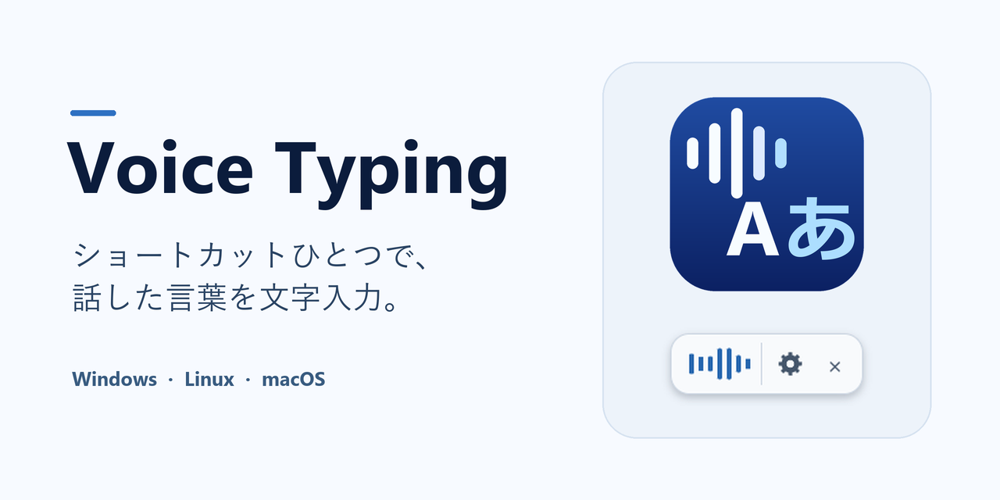
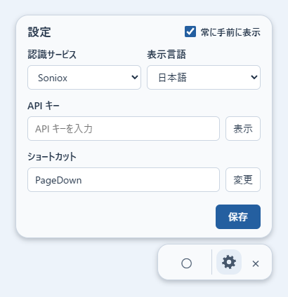
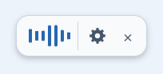

<h1 align="center">
  
</h1>

  <a href="#準備">準備</a> · <a href="#ダウンロードと起動">ダウンロード</a> · <a href="#使い方">3ステップで使う</a> · <a href="#モデルと料金">モデルと料金</a> · <a href="README.md">English</a>

  
  

## 準備

使う音声認識サービスの API キーを用意します。

| サービス | 取得先 | 取得手順 |
| --- | --- | --- |
| Soniox | [Soniox Console](https://console.soniox.com/) | ログイン後、プロジェクトを選び、**API keys** でキーを作成します。 |
| OpenAI | [OpenAI API keys](https://platform.openai.com/api-keys) | ログイン後、**Create new secret key** を選び、発行されたキーをコピーします。 |

## ダウンロードと起動

お使いの OS に合ったファイルを選び、下の表に沿って起動します。[最新版をダウンロード](https://github.com/sk-guritech/voice-typing/releases/latest)

| OS | 必要な環境 | 起動方法 | 動作確認 |
| --- | --- | --- | --- |
| Windows x64 | WebView2 Runtime | `.exe` をダブルクリックします。 | ○ 確認済み |
| Linux x64 | GTK 3、WebKitGTK 4.1、自動入力には X11 セッション | `.tar.gz` を展開し、`voice-typing` を起動します。 | △ Ubuntu の Xfce コンテナで仮想マイクから自動入力まで確認 |
| macOS（Intel） | macOS 13 以降 | x64 用の ZIP を展開し、`Voice Typing.app` を開きます。 | ○ macOS 15.7.9 で確認済み |
| macOS（Apple Silicon） | macOS 13 以降 | arm64 用の ZIP を展開し、`Voice Typing.app` を開きます。 | × 実機未確認（CI で起動確認済み） |

Intel Mac の実機で、マイクでの音声入力と自動入力を確認しました。Linux の自動入力は `main` のビルドで利用できます。検証には仮想マイクとテスト用の認識応答を使いました。Wayland での自動入力は現在未対応です。

## 使い方

1. **設定する。** 歯車を押してサービスを選び、API キーを入力して **保存** します。ショートカットや「常に手前に表示」の設定もここで変更できます。

   

2. **話す。** 入力欄にカーソルを置いて <kbd>Page Down</kbd> を押し、青い波形が動いたら話します。

   

3. **文字を入力する。** <kbd>Page Down</kbd> をもう一度押すと、話した内容が入力されます。

### macOSの権限

**システム設定 → プライバシーとセキュリティ** で、音声入力に必要な **マイク** と、自動貼り付けに必要な **アクセシビリティ** を許可します。両方を設定してから Voice Typing を開き直せます。

簡易署名のビルドを更新した後、**アクセシビリティ** がオンでも許可を求められる場合は、旧ビルドの署名に対する許可が残っている可能性があります。古い Voice Typing の項目を削除し、現在の `Voice Typing.app` を追加して開き直します。[Appleのアクセシビリティ設定ガイド](https://support.apple.com/ja-jp/guide/mac-help/mh43185/mac)

## モデルと料金

料金は音声 1 時間あたりの米ドルです（2026 年 11 月確認）。トークン課金のモデルは目安です。[Soniox の料金](https://soniox.com/pricing#speech-to-text-api-pricing) · [OpenAI の料金](https://platform.openai.com/pricing)

| サービス | モデル | API 料金（1 時間） |
| --- | --- | ---: |
| Soniox | [`stt-rt-v6`](https://docs.soniox.com/stt/models#november-3-2026)（アプリの初期設定） | \$0.12 |
| Soniox | [`stt-rt-v5`](https://docs.soniox.com/stt/models#june-16-2026) | \$0.12 |
| OpenAI | [`gpt-transcribe`](https://developers.openai.com/api/docs/models/gpt-transcribe) | \$0.27 |
| OpenAI | [`gpt-4o-transcribe`](https://developers.openai.com/api/docs/models/gpt-4o-transcribe) | \$0.36 |
| OpenAI | [`gpt-4o-mini-transcribe`](https://developers.openai.com/api/docs/models/gpt-4o-mini-transcribe) | \$0.18 |
| OpenAI | [`whisper-1`](https://developers.openai.com/api/docs/models/whisper-1) | \$0.36 |

どのモデルでも、文字の入力は録音終了後です。

## 問題を報告する

使っている OS、アプリのバージョン、問題が起きたときの操作と結果を書いてください。画像やログを添える前に、API キーや個人情報を消してください。[GitHub で問題を報告する](https://github.com/sk-guritech/voice-typing/issues/new)

開発者向けの軽量版ビルド手順

Go 1.27.4 を使います。以下のコマンドは `webview/` で実行します。

- **Windows（WebView2 Runtime）** — `go build -tags production -trimpath -ldflags "-s -w -H windowsgui" -o ../release/Voice-Typing.exe .`
- **Linux（GTK 3、WebKitGTK 4.1。Ubuntu コンテナで確認済み）** — Bash で `docker build -t voice-typing:linux .` の後、`docker run --rm voice-typing:linux tar -cz -C /usr/local/bin voice-typing > ../release/Voice-Typing-linux-x64.tar.gz` を実行します。
- **macOS（macOS 13 以降）** — Apple のコマンドラインツールが入った Mac で `bash build-macos.sh` を実行します。

## ライセンス

[MIT](LICENSE)
