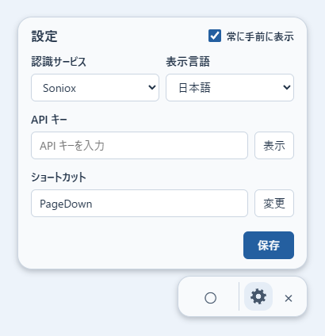

  

<h1 align="center">Voice Typing</h1>

<strong>A small desktop panel for voice typing.</strong>

Use a shortcut to dictate with Soniox or OpenAI.

  <a href="#run">Run the app</a> · <a href="#get-an-api-key">Get an API key</a> · <a href="#quick-start">Quick start</a> · <a href="README.ja.md">日本語</a>

## Run

Build locally using the commands below. The packages go in [`release/`](release/).

| OS | Requirements | Launch | Tested on a desktop |
| --- | --- | --- | --- |
| Windows x64 | WebView2 Runtime | Run the `.exe`. | ○ Verified |
| Linux x64 | GTK 3 and WebKitGTK 4.1 | Extract the `.tar.gz` and run `voice-typing`. | × Unverified (Ubuntu container tested) |
| macOS (Apple Silicon or Intel) | macOS 13 or later | Extract the ZIP and open `Voice Typing.app`. | × Unverified on a physical Mac |

The macOS app is ad hoc signed.

## Get an API key

Create a key for the speech recognition service you want to use.

- **Soniox** — Sign in, select a project, and create a key under **API keys**. [Soniox Console](https://console.soniox.com/)
- **OpenAI** — Sign in, choose **Create new secret key**, and copy the key. [OpenAI API keys](https://platform.openai.com/api-keys)

## Quick start

1. **Set up.** Open the gear, choose Soniox or OpenAI, enter the API key, and click **Save** (保存). Selecting **Language** (表示言語) switches the UI immediately. The gear also lets you change the shortcut and keep the panel on top.

   

2. **Record.** On Windows, put the cursor where you want the text. On Linux and macOS, focus the panel. Press <kbd>Page Down</kbd> and speak when the blue waveform moves.

   

3. **Get the text.** Press <kbd>Page Down</kbd> again. When recording starts with the shortcut on Windows, the result is pasted into the original field if it still has focus. You can also paste the result from your clipboard.

## Report a problem

Include your OS, Voice Typing version, what you did, and what happened. Remove API keys and personal information from screenshots and logs before sharing. [Open a GitHub issue](https://github.com/sk-guritech/voice-typing/issues/new)

Build locally

Use Go 1.27.4 from `webview/`.

- **Windows** — `go build -tags production -trimpath -ldflags "-s -w -H windowsgui" -o ../release/Voice-Typing-1.1.0-windows-x64.exe .`
- **Linux (Bash)** — Run `docker build -t voice-typing:linux .`, then `docker run --rm voice-typing:linux tar -cz -C /usr/local/bin voice-typing > ../release/Voice-Typing-1.1.0-linux-x64.tar.gz`.
- **macOS** — Run `bash build-macos.sh` on a Mac with Apple command line tools installed.

