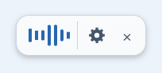

  

<h1 align="center">Voice Typing</h1>

<strong>Type with your voice using a single shortcut.</strong>

  <a href="#get-an-api-key">Get an API key</a> · <a href="#download-and-run">Download and run</a> · <a href="#quick-start">Quick start</a> · <a href="#models-and-pricing">Models and pricing</a> · <a href="README.ja.md">日本語</a>

## Get an API key

Create a key for the speech recognition service you want to use.

| Service | Where to get a key | Steps |
| --- | --- | --- |
| Soniox | [Soniox Console](https://console.soniox.com/) | Sign in, select a project, and create a key under **API keys**. |
| OpenAI | [OpenAI API keys](https://platform.openai.com/api-keys) | Sign in, choose **Create new secret key**, and copy the key. |

## Download and run

Download the file for your computer, open it, and set up an API key in the gear menu. [Download the latest release](https://github.com/sk-guritech/voice-typing/releases/latest)

| OS | File to choose | Launch | Tested on a desktop |
| --- | --- | --- | --- |
| Windows x64 | `.exe` | Double-click the file. | ○ Verified |
| Linux x64 | AppImage / `.tar.gz` | Make the AppImage executable and open it, or extract the archive and run `voice-typing`. | × Unverified |
| macOS | Apple silicon (arm64) or Intel (x64) ZIP | Extract the ZIP and open `Voice Typing.app`. | × Unverified on a physical Mac |

## Quick start

1. **Set up.** Open the gear, choose Soniox or OpenAI, enter the API key, and click **Save** (保存). The gear also lets you change the shortcut and keep the panel on top.

   

2. **Speak.** On Windows, put the cursor where you want the text. On Linux and macOS, focus the panel. Press <kbd>Page Down</kbd> and speak when the blue waveform moves.

   

3. **Enter the text.** Press <kbd>Page Down</kbd> again to enter what you said (Linux and macOS copy it to the clipboard).

## Models and pricing

Prices are in US dollars per hour of audio, checked in November 2026. Rates for token-billed models are estimates. [Soniox pricing](https://soniox.com/pricing#speech-to-text-api-pricing) · [OpenAI pricing](https://platform.openai.com/pricing)

| Service | Model | API cost (USD/hour) | Processing in this app | Accuracy characteristics |
| --- | --- | ---: | --- | --- |
| Soniox | [`stt-rt-v6`](https://docs.soniox.com/stt/models#november-3-2026) (default) | About 0.12 | During recording | Better recognition of accents and mixed-language speech than v5 |
| Soniox | [`stt-rt-v5`](https://docs.soniox.com/stt/models#june-16-2026) | About 0.12 | During recording | Better recognition of noisy and multilingual audio than v4 |
| OpenAI | [`gpt-transcribe`](https://developers.openai.com/api/docs/models/gpt-transcribe) (default) | 0.27 | After recording | OpenAI's recommended high-accuracy model for recorded audio |
| OpenAI | [`gpt-4o-transcribe`](https://developers.openai.com/api/docs/models/gpt-4o-transcribe) | About 0.36 | After recording | Fewer word errors and better language recognition than Whisper |
| OpenAI | [`gpt-4o-mini-transcribe`](https://developers.openai.com/api/docs/models/gpt-4o-mini-transcribe) | About 0.18 | After recording | Smaller model with fewer word errors than Whisper |
| OpenAI | [`whisper-1`](https://developers.openai.com/api/docs/models/whisper-1) | 0.36 | After recording | General-purpose multilingual recognition |

Voice Typing outputs text after recording ends for every model. The accuracy descriptions come from the providers' documentation.

## Report a problem

Include your OS, Voice Typing version, what you did, and what happened. Remove API keys and personal information from screenshots and logs before sharing. [Open a GitHub issue](https://github.com/sk-guritech/voice-typing/issues/new)

Build the lightweight app from source

Use Go 1.27.4 from `webview/`.

- **Windows (WebView2 Runtime)** — `go build -tags production -trimpath -ldflags "-s -w -H windowsgui" -o ../release/Voice-Typing-windows-x64.exe .`
- **Linux (GTK 3 and WebKitGTK 4.1, tested in an Ubuntu container)** — In Bash, run `docker build -t voice-typing:linux .`, then `docker run --rm voice-typing:linux tar -cz -C /usr/local/bin voice-typing > ../release/Voice-Typing-linux-x64.tar.gz`.
- **macOS (macOS 13 or later)** — Run `bash build-macos.sh` on a Mac with Apple command line tools installed.

