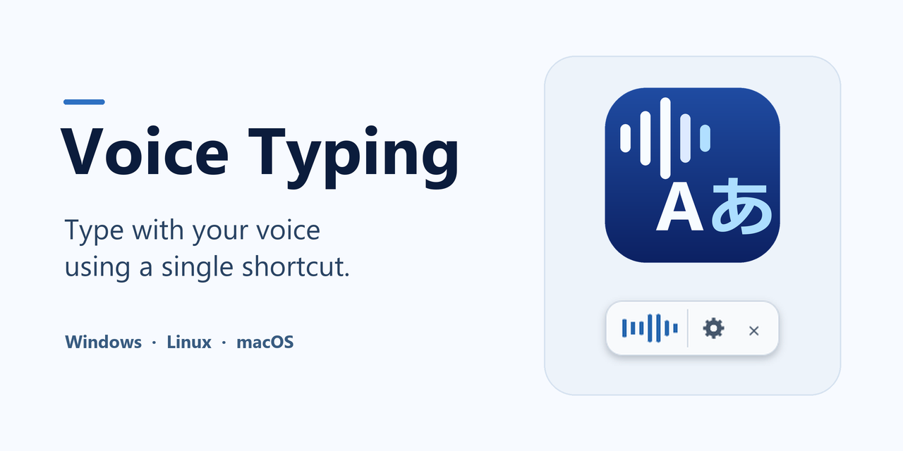
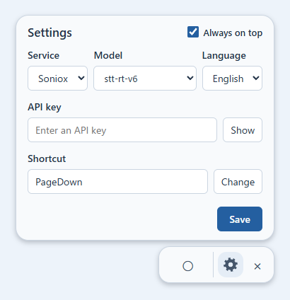

<h1 align="center">
  
</h1>

  <a href="#get-an-api-key">Get an API key</a> · <a href="#download-and-run">Download and run</a> · <a href="#quick-start">Quick start</a> · <a href="#models-and-pricing">Models and pricing</a> · <a href="README.ja.md">日本語</a>

  
  

## Get an API key

Create a key for the speech recognition service you want to use.

| Service | Where to get a key | Steps |
| --- | --- | --- |
| Soniox | [Soniox Console](https://console.soniox.com/) | Sign in, select a project, and create a key under **API keys**. |
| OpenAI | [OpenAI API keys](https://platform.openai.com/api-keys) | Sign in, choose **Create new secret key**, and copy the key. |

## Download and run

Download the file for your computer, open it, and set up an API key in the gear menu. [Download the latest release](https://github.com/sk-guritech/voice-typing/releases/latest)

| OS | Requirements | Launch | Verification |
| --- | --- | --- | --- |
| Windows x64 | WebView2 Runtime | Double-click the `.exe`. | ○ Verified |
| Linux x64 | GTK 3 and WebKitGTK 4.1 | Extract the `.tar.gz` and run `voice-typing`. | △ Virtual microphone and clipboard tested in an Ubuntu container |
| macOS (Intel) | macOS 13 or later | Extract the x64 ZIP and open `Voice Typing.app`. | ○ Verified on macOS 15.7.9 |
| macOS (Apple silicon) | macOS 13 or later | Extract the arm64 ZIP and open `Voice Typing.app`. | × No physical Mac tested (launch verified in CI) |

Dictation with a physical microphone and automatic pasting were tested on an Intel Mac. The Linux test used a virtual microphone and a simulated transcription response.

## Quick start

1. **Set up.** Click the gear to open **Settings**. If the panel opens in Japanese, set **Language** (表示言語) to **English**. Choose Soniox or OpenAI under **Service**, enter your **API key**, and click **Save**.

   

2. **Speak.** On Windows and macOS, put the cursor where you want the text. On Linux, focus the panel. Press <kbd>Page Down</kbd> and speak when the blue waveform moves.

   

3. **Enter the text.** Press <kbd>Page Down</kbd> again to finish. On Linux, paste the result from the clipboard.

### macOS permissions

In **System Settings → Privacy & Security**, allow **Microphone** for dictation and **Accessibility** for automatic pasting. You can set both permissions before reopening Voice Typing.

If **Accessibility** is on but Voice Typing still asks for permission after an ad hoc-signed update, macOS may have kept the previous build's permission. Remove the old Voice Typing entry, add the current `Voice Typing.app`, and reopen it. [Apple's Accessibility guide](https://support.apple.com/guide/mac-help/allow-accessibility-apps-to-access-your-mac-mh43185/mac)

## Models and pricing

Prices are in US dollars per hour of audio, checked in November 2026. Rates for token-billed models are estimates. [Soniox pricing](https://soniox.com/pricing#speech-to-text-api-pricing) · [OpenAI pricing](https://platform.openai.com/pricing)

| Service | Model | API cost per hour |
| --- | --- | ---: |
| Soniox | [`stt-rt-v6`](https://docs.soniox.com/stt/models#november-3-2026) (app default) | \$0.12 |
| Soniox | [`stt-rt-v5`](https://docs.soniox.com/stt/models#june-16-2026) | \$0.12 |
| OpenAI | [`gpt-transcribe`](https://developers.openai.com/api/docs/models/gpt-transcribe) | \$0.27 |
| OpenAI | [`gpt-4o-transcribe`](https://developers.openai.com/api/docs/models/gpt-4o-transcribe) | \$0.36 |
| OpenAI | [`gpt-4o-mini-transcribe`](https://developers.openai.com/api/docs/models/gpt-4o-mini-transcribe) | \$0.18 |
| OpenAI | [`whisper-1`](https://developers.openai.com/api/docs/models/whisper-1) | \$0.36 |

Voice Typing outputs text after recording ends for every model.

## Report a problem

Include your OS, Voice Typing version, what you did, and what happened. Remove API keys and personal information from screenshots and logs before sharing. [Open a GitHub issue](https://github.com/sk-guritech/voice-typing/issues/new)

Build the lightweight app from source

Use Go 1.27.4 from `webview/`.

- **Windows (WebView2 Runtime)** — `go build -tags production -trimpath -ldflags "-s -w -H windowsgui" -o ../release/Voice-Typing.exe .`
- **Linux (GTK 3 and WebKitGTK 4.1, tested in an Ubuntu container)** — In Bash, run `docker build -t voice-typing:linux .`, then `docker run --rm voice-typing:linux tar -cz -C /usr/local/bin voice-typing > ../release/Voice-Typing-linux-x64.tar.gz`.
- **macOS (macOS 13 or later)** — Run `bash build-macos.sh` on a Mac with Apple command line tools installed.

## License

[MIT](LICENSE)
